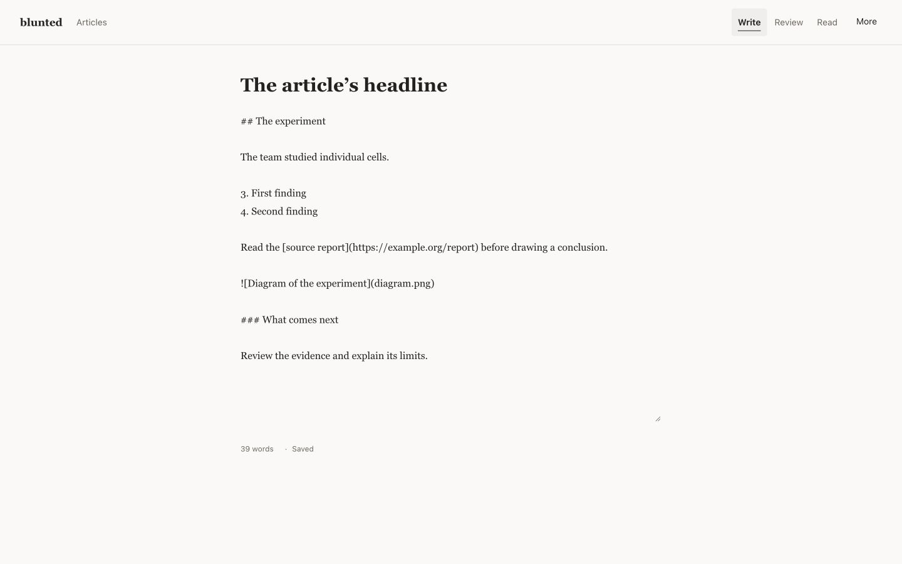

# blunted — offline writing clarity for Mac and Windows

Write essays, explainers and opinion pieces entirely offline. Draft in Markdown,
organize with an outline, read a clean preview, then choose a Clarity or Structure
review. Keep your voice: notes are prompts for your judgment, and changes require
an explicit action. No accounts, network, telemetry or sync — forever free.

The desktop source now includes a small local article library: create, search,
rename, move to trash and restore. Each article saves independently with rotating
backups. Export individual articles or back up the whole library. Portable HTML
keeps its single-draft workflow. These features ship in v1.0.0; older builds do not include them. See [the article workflow and acceptance status](docs/article-workspace.md).

v1.1.0 adds recovery and persistence repairs. See the
[implementation evidence and remaining acceptance](docs/implementation-evidence-2026-10-26.md)
and [v1.1.0 notes and local app cleanup](docs/v1.1-release.md).

Find (Cmd/Ctrl+F), bold/italic (Cmd/Ctrl+B / Cmd/Ctrl+I), and next/previous
review note (F2 / Shift+F2) work from the keyboard. New articles start in Write
mode. Preferences remain available while drafting; reading scores stay secondary.



## Paste and flag

Paste this sentence into the editor:

> It is important to note that the report was written in order to utilize the new method.

Review mode flags possible wordiness, passive voice, and a phrase to
reconsider. These are prompts for your judgment, not automatic corrections.

## Profiles and controls

Choose Clear for general prose or Essay for longer essays. Profiles tune sentence
and paragraph thresholds; Clarity and Structure are separate reviewers. Adjust
thresholds, tune each rule, add words that reflect your voice, or request
suggestions from a sample. Sample suggestions require your approval. A
highlight means **review**, not wrong. See `docs/clarity.md`.

## Download & run

Get [blunted v1.1.0](https://github.com/therawlogs/blunted/releases/tag/v1.1.0):
Mac Apple Silicon DMG, Windows x64 installer, or portable `index.html`.

The Mac app is ad-hoc signed, without Developer ID signing or notarization.
The Windows installer is unsigned. Compare downloads with the release's
`SHA256SUMS.txt`. See [Mac details](docs/mac-release.md) and
[Windows details](docs/win-release.md) for platform limitations.

For portable HTML, download `index.html` and open it locally in your browser.
Desktop first run asks for a local save folder; that choice persists across
updates. All writing and review runs offline. The desktop edition includes the
article library; portable HTML keeps one draft.

Clean-machine offline installation and independent writer acceptance remain
pending; see [validation](docs/minimalism-validation.md). v0.1.5 remains withdrawn.

## Offline / privacy (with limits)

Analysis runs on-device; there is nothing to phone home to. Draft recovery
(localStorage on web, independent article files in a chosen local folder on desktop) is convenience storage —
a 3-slot rotating backup restores automatically with a visible notice —
**not** encrypted sync. Anyone with device access may read it. There is
no sync and there will never be one: your backup is your sync — copy the
exported `.md` where you like. Details: `docs/privacy.md`.

## Build from source

```sh
node --version   # >= 20
npm test         # engine and startup regression fixtures
npm run build    # -> dist/index.html (~200 KB, deterministic)
```

Mac shell (Apple Silicon; needs Xcode Command Line Tools + Rust):

```sh
npm run build:tauri:mac
```

Windows shell (x64; needs MSVC + Rust — or use CI):

```sh
npm run build:tauri:win
```

## Scores and detectors — read this

- Grades are **estimates from surface counts** (ARI primary; Flesch-Kincaid
  and Coleman-Liau as details). They don’t know your reader, argument, or
  whether a term is necessary. Below 100 words / 5 sentences the steady grade
  is suppressed; an explicit early estimate shows from ~30 words with the
  selected profile target marked (Clear starts at grade 8; Essay at 12).
- **English-first.** Other scripts stay editable and export intact, but
  English scores/rules are suppressed for clearly non-English input. French
  and other languages may come later; the engine stays English-only for now.
- Detectors are heuristics with documented false positives (`docs/rules.md`).
  No grammar checking, no semantic rewrites, no tone judgment, no citation
  checking.
- blunted itself makes no AI requests. Where your OS offers system writing
  tools (right-click in the editor), they remain available — they run under
  your OS vendor's policy, not blunted's, and blunted sends nothing itself.

## Non-goals

AI, translation, spelling/grammar checks, factual checking, plagiarism,
collaboration, citation management, rich text, accounts, sync,
publishing, analytics, subscriptions, update checks, browser extensions,
Linux binaries, code signing / Store distribution.

## License

MIT — see `LICENSE`. Notices: `THIRD_PARTY_NOTICES.md`. Contributing:
`CONTRIBUTING.md`. Security: `SECURITY.md`.
