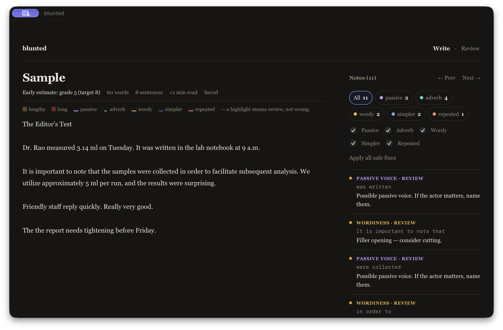

# blunted — offline writing clarity for Mac and Windows

Write, paste, and review English prose offline. Choose a Clear or Essay
profile, tune checks to your style, then Copy, Download (`.md` / `.txt`), or
Print. Drafts autosave locally. No accounts, network, telemetry, or sync —
forever free. Find (Cmd/Ctrl+F),
Download (Cmd/Ctrl+S), and next/previous note (F2 / Shift+F2) work from
the keyboard. The editor defaults to a serif face; change it under Preferences.



## Paste and flag

Paste this sentence into the editor:

> It is important to note that the report was written in order to utilize the new method.

Review mode flags possible wordiness, passive voice, and a phrase to
reconsider. These are prompts for your judgment, not automatic corrections.

## Profiles and controls

Choose Clear for general prose or Essay for longer academic writing. Adjust
thresholds, tune each rule, add words that reflect your voice, or request
suggestions from a sample. Sample suggestions require your approval. A
highlight means **review**, not wrong. See `docs/clarity.md`.

## Download & run (unsigned dev preview)

Both desktop builds are **unsigned** (no paid certificates, no Store —
this project stays free). Your OS will warn on first run; that is
expected. Do not disable Gatekeeper/SmartScreen system-wide. The safest
path is the portable file:

1. Download the portable HTML file from the release (e.g. `index.html`).
2. Turn networking off if you like — double-click it. Everything works.
3. Write. Drafts autosave locally. Desktop first run asks once for a save
   folder; the choice persists across app updates. Copy or Download (`.md` /
   `.txt`) when done.
   Nothing leaves the device.

Mac: Gatekeeper warns about an unidentified developer (details:
`docs/mac-release.md`). Windows: SmartScreen warns about an unrecognized
app; verify the SHA-256 hash first (details: `docs/win-release.md`).

## Offline / privacy (with limits)

Analysis runs on-device; there is nothing to phone home to. Draft recovery
(localStorage on web, a chosen local folder on desktop) is convenience storage —
a 3-slot rotating backup restores automatically with a visible notice —
**not** encrypted sync. Anyone with device access may read it. There is
no sync and there will never be one: your backup is your sync — copy the
exported `.md` where you like. Details: `docs/privacy.md`.

## Build from source

```sh
node --version   # >= 20
npm test         # engine and startup regression fixtures
npm run build    # -> dist/index.html (~200 KB, deterministic)
```

Mac shell (Apple Silicon; needs Xcode Command Line Tools + Rust):

```sh
npm run build:tauri:mac
```

Windows shell (x64; needs MSVC + Rust — or use CI):

```sh
npm run build:tauri:win
```

## Scores and detectors — read this

- Grades are **estimates from surface counts** (ARI primary; Flesch-Kincaid
  and Coleman-Liau as details). They don’t know your reader, argument, or
  whether a term is necessary. Below 100 words / 5 sentences the steady grade
  is suppressed; an explicit early estimate shows from ~30 words with the
  selected profile target marked (Clear starts at grade 8; Essay at 12).
- **English-first.** Other scripts stay editable and export intact, but
  English scores/rules are suppressed for clearly non-English input. French
  and other languages may come later; the engine stays English-only for now.
- Detectors are heuristics with documented false positives (`docs/rules.md`).
  No grammar checking, no semantic rewrites, no tone judgment, no citation
  checking.
- blunted itself makes no AI requests. Where your OS offers system writing
  tools (right-click in the editor), they remain available — they run under
  your OS vendor's policy, not blunted's, and blunted sends nothing itself.

## Non-goals

AI, translation, spelling/grammar checks, factual checking, plagiarism,
collaboration, multi-document library, rich text, accounts, sync,
publishing, analytics, subscriptions, update checks, browser extensions,
Linux binaries, code signing / Store distribution.

## License

MIT — see `LICENSE`. Notices: `THIRD_PARTY_NOTICES.md`. Contributing:
`CONTRIBUTING.md`. Security: `SECURITY.md`.
